# 🌐 Awesome P2P & BitTorrent Clients

  

  
  
  
  
  
  
  

---

## 📖 Executive Summary & Ecosystem Overview

The **Peer-to-Peer (P2P) and BitTorrent Ecosystem** represents the bedrock of decentralized content delivery, resilient high-speed file distribution, and censorship-resistant data transfers across the global Internet. While initial consumer awareness centered around desktop downloaders, modern P2P architecture has evolved into a multi-tiered landscape spanning **headless background seedboxes**, **in-browser WebRTC swarms**, **FUSE-mounted torrent filesystems**, **automated IRC race-grabbers**, and **cloud-hosted debrid caching engines**.

This curated directory tracks both **enterprise-grade SaaS platforms / cloud seedbox services** and **battle-tested open-source GitHub projects**. Every project is evaluated for resource efficiency, protocol fidelity (BitTorrent v1 and v2, BEP specifications, DHT, PEX, MSE/PE encryption), ad-free operation, and headless deployment capabilities.

---

## 📑 Table of Contents

- [🌐 Sector Overview & Market Dynamics](#-sector-overview--market-dynamics)
- [🏢 SaaS & Commercial Torrent Platforms](#-saas--commercial-torrent-platforms)
- [💻 Open-Source BitTorrent Clients & Tools](#-open-source-bittorrent-clients--tools)
  - [📊 Star Ranking Matrix](#-star-ranking-matrix)
  - [🔍 In-Depth Open-Source Breakdown](#-in-depth-open-source-breakdown)
- [⚖️ Client Selection & Decision Matrix](#️-client-selection--decision-matrix)
- [🛡️ Privacy, Security & Best Practices](#️-privacy-security--best-practices)
- [🤝 How to Contribute](#-how-to-contribute)
- [📈 Star History](#-star-history)
- [💖 Support & Community](#-support--community)
- [📜 License & Disclaimer](#-license--disclaimer)

---

## 🌐 Sector Overview & Market Dynamics

The global peer-to-peer (P2P) file sharing and decentralized distribution software market is estimated at approximately **$1.8B – $2.4B**, driven by commercial client licensing, cloud seedbox infrastructure, high-throughput debrid transit networks, and decentralized content delivery networks (dCDNs).

Market concentration across the ecosystem is **moderately concentrated** at the consumer desktop layer — where a handful of community open-source staples (notably the libtorrent rasterbar ecosystem and qBittorrent) and legacy commercial titans (Rainberry's uTorrent and BitTorrent) command over 80% of daily active download volume. Conversely, the cloud seedbox hosting, Usenet hybrid, and premium debrid caching tier is **highly fragmented**, characterized by hundreds of independent hosting providers, specialized regional server clusters, and custom WebUI integrations competing fiercely on gigabit peering transit, storage margins, and privacy compliance.

---

## 🏢 SaaS & Commercial Torrent Platforms

The following table provides an exhaustive breakdown of commercial BitTorrent clients, hosted seedbox providers, and cloud debrid caching SaaS platforms. Platforms are sorted in **descending order by company valuation and estimated annual revenue**.

| 🏷️ Platform / Product | 🏛️ Company Size (Valuation / Revenue) | 💳 Starting Tier Pricing | 🎁 Free Tier / Trial Limits | ⚡ Key Capabilities & Protocol Specs | 🖥️ Supported Platforms |
| :--- | :--- | :--- | :--- | :--- | :--- |
| **[uTorrent](https://www.utorrent.com/) (Pro / Web)** | **TRON DAO / Rainberry, Inc.** Valuation: **~$15.0 Billion** (TRX Ecosystem) Revenue: **~$75M+/year** | **$4.95/year** *(Ad-Free tier)* Pro: **$19.95/year** Pro+VPN: **$69.95/year** | **Free forever plan** with permanent in-app sidebar banner ads and sponsored partner software offers; basic torrent protocol features | Micro-sized binary footprint, remote web browser controller, stream-while-downloading media player in Pro, auto-threat detection | Windows, Android, Web Browser |
| **[BitTorrent Classic](https://www.bittorrent.com/) (Pro)** | **TRON DAO / Rainberry, Inc.** Valuation: **~$15.0 Billion** (TRX Ecosystem) Revenue: **~$75M+/year** | **$4.95/year** *(Ad-Free tier)* Pro: **$19.95/year** Pro+CyberGhost: **$69.95/year** | **Free forever plan** with permanent sponsored banner ads in sidebar and installer promotions; standard speed throttling schedules | Original protocol flagship, automated dynamic bandwidth allocation, peer pairing to BitTorrent Android remote | Windows, Android, macOS (Web) |
| **[Real-Debrid](https://real-debrid.com/)** | **Real-Debrid France** *(Private SaaS)* Valuation: **~$65 Million** Revenue: **~$18 Million/year** | **€3.00 (~$3.25) / 15 days** €4.00 / 30 days €16.00 / 180 days | **Free forever "Happy Hours" plan** granting unrestricted high-speed cloud downloads strictly between **06:00 AM and 12:00 PM UTC daily**; 0 fidelity points | Instant cloud torrent caching over 10 Gbps multi-carrier links, HTTPS high-speed direct downloads, WebDAV media mounting, Kodi/Stremio integrations | Cloud SaaS (REST API, Web, Chrome, Firefox, Kodi, Stremio) |
| **[Put.io](https://put.io/)** | **Put.io Inc.** *(Private SaaS)* Valuation: **~$20 Million** Revenue: **~$7 Million/year** | **$9.99/month** *(Basic: 100 GB cloud disk storage, 10 active torrent slots)* | **1-day paid evaluation trial** offering 10 GB storage and 3 active download slots for **$0.99**; strictly 0 permanently free storage tier | Fetches torrents to private remote cloud servers at multi-gigabit speeds, automated cloud MP4 transcoding, instant RSS watch folders | Cloud SaaS (Web, Apple TV, iOS, Android, Kodi, IFTTT) |
| **[Ultra.cc](https://ultra.cc/)** | **Ultra Limited** *(Private Infrastructure SaaS)* Valuation: **~$15 Million** Revenue: **~$6 Million/year** | **€4.95/month (~$5.40/month)** *(Essential: 1 TB high-speed storage, 2 TB monthly upload quota, 20 Gbps shared uplink)* | **7-day full refund evaluation window** with unconditional 100% money-back guarantee; no permanently free seedbox servers | Managed European NVMe/HDD seedboxes, automated 1-click app installers (qBittorrent, Deluge, Plex, *arr suite), high-priority public/private peering | Cloud Linux Seedbox (Web Dashboard, SSH, sFTP, OpenVPN) |
| **[Premiumize.me](https://www.premiumize.me/)** | **Premiumize Operations** *(Private SaaS)* Valuation: **~$12 Million** Revenue: **~$5 Million/year** | **€9.99/month (~$10.85/month)** billed annually (€119.88/yr) or **€14.99 / 30 days** | **Free trial account** activated via 7-day promotional vouchers; unboosted accounts receive **0 GB active cloud storage space** | Triple hybrid system combining cloud torrent seedbox, Usenet NZB downloader, 1 TB encrypted personal cloud drive, and multi-protocol VPN | Cloud SaaS (Web, Android, iOS, Chrome, Firefox, JDownloader2) |
| **[Bitport.io](https://bitport.io/)** | **Bitport s.r.o.** *(Private SaaS)* Valuation: **~$7 Million** Revenue: **~$3 Million/year** | **$5.00/month** *(Small Plan: 30 GB cloud storage, 5 concurrent download slots, gigabit speeds)* | **Free forever plan** capped at **1 GB cloud storage**, **1 concurrent download slot**, **1 torrent fetch per 24 hours**, and standard download speeds | Downloads torrents directly to secure cloud drive without exposing user IP address, built-in browser media player, antivirus scanning | Cloud SaaS (Web, iOS, Android, Roku, Apple TV, Chromecast) |
| **[Vuze](https://www.vuze.com/) (Vuze Plus)** | **Azureus / Spigot, Inc.** Valuation: **~$6 Million** *($34M total VC funding)* Revenue: **~$2 Million/year** | **$9.90/year** *(Vuze Plus annual license)* or **$2.99/month** *(quarterly plan)* | **Free forever plan** bundled with third-party installer advertisements and sponsored app banners; excludes built-in DVD burning & stream-during-download | Feature-dense Java torrent suite, distributed database tracker, I2P routing plugins, customizable swarm analytics | Windows, macOS, Linux |

---

## 💻 Open-Source BitTorrent Clients & Tools

The open-source BitTorrent ecosystem offers zero-cost, privacy-respecting, and completely ad-free alternatives to commercial clients. Below is the ranked catalog of repositories, **sorted in descending order by GitHub stargazers count**.

### 📊 Star Ranking Matrix

| 🏆 Rank | 📦 Project Name | ⭐ GitHub Star Count Badge | 🛠️ Primary Language | 🎯 Primary Architecture / Focus |
| :---: | :--- | :---: | :---: | :--- |
| **#1** | **[aria2](https://github.com/aria2/aria2)** |  | C++ | Multi-protocol CLI engine (BitTorrent, HTTP, FTP, Metalink) |
| **#2** | **[qBittorrent](https://github.com/qbittorrent/qBittorrent)** |  | C++ (Qt6) | Universal desktop & headless web client; libtorrent-powered |
| **#3** | **[WebTorrent](https://github.com/webtorrent/webtorrent)** |  | JavaScript | In-browser & Node.js streaming torrent engine via WebRTC |
| **#4** | **[Transmission](https://github.com/transmission/transmission)** |  | C++ / Cocoa | Lightweight native desktop client (<40MB RAM) & headless daemon |
| **#5** | **[WebTorrent Desktop](https://github.com/webtorrent/webtorrent-desktop)** |  | JavaScript / Electron | Instant streaming media torrent player for Mac, Windows, and Linux |
| **#6** | **[VueTorrent](https://github.com/VueTorrent/VueTorrent)** |  | Vue.js / TypeScript | Modern, responsive dark-mode WebUI frontend for qBittorrent |
| **#7** | **[anacrolix/torrent](https://github.com/anacrolix/torrent)** |  | Go | Full-featured BitTorrent client package, DHT, and HTTP streamer |
| **#8** | **[Tribler](https://github.com/Tribler/tribler)** |  | Python / PyQt | Anonymity-focused client with integrated multi-hop onion routing |
| **#9** | **[rTorrent](https://github.com/rakshasa/rtorrent)** |  | C++ | High-performance ncurses terminal client built on LibTorrent |
| **#10** | **[LibreTorrent](https://github.com/proninyaroslav/libretorrent)** |  | Java / Kotlin | Ad-free, fully open-source torrent client for Android devices |
| **#11** | **[BTFS](https://github.com/johang/btfs)** |  | C++ / FUSE | BitTorrent filesystem; mounts torrents/magnets as local folders |
| **#12** | **[autobrr](https://github.com/autobrr/autobrr)** |  | Go / React | High-speed torrent automation & IRC announce filter pipeline |
| **#13** | **[Flood](https://github.com/jesec/flood)** |  | TypeScript / React | Sleek web interface for rTorrent, qBittorrent, and Transmission |
| **#14** | **[PicoTorrent](https://github.com/picotorrent/picotorrent)** |  | C++ / Win32 | Tiny, native Win32 desktop client with PQL query filtering |
| **#15** | **[ruTorrent](https://github.com/Novik/ruTorrent)** |  | PHP / JavaScript | Classic uTorrent-style web GUI and plugin framework for rTorrent |
| **#16** | **[BiglyBT](https://github.com/BiglySoftware/BiglyBT)** |  | Java / SWT | Feature-complete ad-free Vuze fork with Swarm Merging & I2P |
| **#17** | **[Deluge](https://github.com/deluge-torrent/deluge)** |  | Python / GTK | Client-server architecture with daemon (`deluged`) & modular plugins |
| **#18** | **[Rain](https://github.com/cenkalti/rain)** |  | Go | Concurrency-focused BitTorrent client & library with CLI and WebUI |

---

### 🔍 In-Depth Open-Source Breakdown

#### 1. [aria2](https://github.com/aria2/aria2) 
- **License**: GPL-2.0
- **Tech Stack**: C++, libuv, GnuTLS/OpenSSL
- **Core Strengths**: Ultra-fast multi-protocol download engine capable of utilizing maximum socket bandwidth across BitTorrent, HTTP, HTTPS, FTP, and Metalink. Controllable via XML-RPC and JSON-RPC APIs.
- **Ideal Use Case**: Command-line power users, automated NAS container downloads, shell scripting, and integration with browser download extensions.

#### 2. [qBittorrent](https://github.com/qbittorrent/qBittorrent) 
- **License**: GPL-2.0
- **Tech Stack**: C++, Qt6, libtorrent-rasterbar (v1.2 & v2.0 branches)
- **Core Strengths**: The gold-standard open-source BitTorrent client. Clones the classic lightweight uTorrent 2.x interface without ads or bloatware. Features built-in search engine plugins, sequential downloading, IP filtering, advanced RSS auto-downloader rules, and an integrated WebUI.
- **Ideal Use Case**: Universal daily desktop client on Windows, macOS, and Linux, as well as headless home server / NAS deployments via `qbittorrent-nox`.

#### 3. [WebTorrent](https://github.com/webtorrent/webtorrent) 
- **License**: MIT
- **Tech Stack**: JavaScript, Node.js, WebRTC, WebCrypto
- **Core Strengths**: First torrent client built directly for the web. Enables browser-to-browser peer file sharing using WebRTC data channels without requiring browser plugins or native installations. Can bridge WebTorrent swarms with regular BitTorrent swarms via hybrid peers.
- **Ideal Use Case**: Web developers building decentralized streaming media apps, distributed web hosting, and browser-native P2P protocols.

#### 4. [Transmission](https://github.com/transmission/transmission) 
- **License**: GPL-2.0 / GPL-3.0
- **Tech Stack**: C++, Objective-C/Cocoa, GTK, Qt, JSON-RPC 2.0
- **Core Strengths**: Minimalist native desktop client idling at under 40 MB of RAM. Default torrent client in GNOME and Ubuntu. Provides native macOS Aqua UI, clean Linux GTK/Qt interfaces, and a robust background daemon (`transmission-daemon`) with JSON-RPC remote control.
- **Ideal Use Case**: macOS users seeking a Cocoa-native interface, resource-constrained single-board computers (Raspberry Pi), and Linux desktop systems.

#### 5. [WebTorrent Desktop](https://github.com/webtorrent/webtorrent-desktop) 
- **License**: MIT
- **Tech Stack**: JavaScript, Electron, WebTorrent, Node.js
- **Core Strengths**: Instantaneous streaming media torrent client. Starts video playback immediately while downloading in the background. Natively streams to AirPlay, Chromecast, and DLNA devices. Connects seamlessly to both WebTorrent and traditional BitTorrent peers.
- **Ideal Use Case**: Casual users who want to stream audio or video torrents on-demand without waiting for downloads to reach 100%.

#### 6. [VueTorrent](https://github.com/VueTorrent/VueTorrent) 
- **License**: GPL-3.0
- **Tech Stack**: Vue.js 3, TypeScript, Vite, TailwindCSS
- **Core Strengths**: A modern web dashboard replacement for the default qBittorrent WebUI. Offers desktop and mobile responsive layouts, detailed real-time transfer graphs, dark/custom themes, torrent tag management, and tracker monitoring.
- **Ideal Use Case**: Upgrading self-hosted qBittorrent installations to an aesthetic, mobile-friendly interface for phones and tablets.

#### 7. [anacrolix/torrent](https://github.com/anacrolix/torrent) 
- **License**: MPL-2.0
- **Tech Stack**: Go (Golang)
- **Core Strengths**: Production-ready BitTorrent client library written in pure Go. Includes mainline DHT, uTP, BEP 3/9/10/20 extensions, piece encryption, and an integrated HTTP server for streaming torrent files over standard HTTP connections.
- **Ideal Use Case**: Go backend engineers building distributed data distribution pipelines, decentralized storage tools, and microservices.

#### 8. [Tribler](https://github.com/Tribler/tribler) 
- **License**: LGPL-3.0
- **Tech Stack**: Python, PyQt, Libtorrent
- **Core Strengths**: Privacy-first, censorship-resistant P2P platform developed by researchers at Delft University of Technology. Features an embedded multi-hop onion routing network (similar to Tor) that masks IP addresses from swarm peers, accompanied by decentralized metadata search.
- **Ideal Use Case**: Users prioritizing maximum anonymity and censorship circumvention without running a separate commercial VPN tunnel.

#### 9. [rTorrent](https://github.com/rakshasa/rtorrent) 
- **License**: GPL-2.0
- **Tech Stack**: C++, LibTorrent (rakshasa), ncurses, XMLRPC
- **Core Strengths**: Legendary command-line ncurses client renowned for maximum I/O throughput, low resource overhead, and rock-solid stability under heavy load. Capable of managing tens of thousands of active torrents simultaneously on dedicated seedboxes.
- **Ideal Use Case**: Dedicated Linux seedboxes, shell environments, and power users combining rTorrent with ruTorrent or Flood web interfaces.

#### 10. [LibreTorrent](https://github.com/proninyaroslav/libretorrent) 
- **License**: GPL-3.0
- **Tech Stack**: Java, Kotlin, libtorrent4j
- **Core Strengths**: Truly free and open-source Android torrent client based on libtorrent. Features Material Design 3, selective file downloading, IP filtering (eMule .dat and PeerGuardian), proxy support, battery-saver auto-shutdown, and scheduling.
- **Ideal Use Case**: Android mobile and Android TV users seeking a tracker-free, ad-free alternative to uTorrent Android.

#### 11. [BTFS](https://github.com/johang/btfs) 
- **License**: GPL-3.0
- **Tech Stack**: C++, FUSE, libtorrent-rasterbar
- **Core Strengths**: BitTorrent Filesystem implemented via FUSE (Filesystem in Userspace). Allows users to mount any `.torrent` file or magnet link as a virtual read-only directory on Linux and macOS, streaming file content on-demand via standard POSIX system calls.
- **Ideal Use Case**: Instant media playback via standard media players (e.g., `vlc /mnt/torrent/movie.mkv`) without pre-downloading entire archives.

#### 12. [autobrr](https://github.com/autobrr/autobrr) 
- **License**: GPL-2.0
- **Tech Stack**: Go, React, SQLite/PostgreSQL
- **Core Strengths**: High-performance torrent automation tool that listens to IRC announce channels and RSS feeds for instant release grabs. Features fine-grained filtering rules, regex matching, and push webhooks to send torrents to qBittorrent, Deluge, rTorrent, or Transmission within milliseconds.
- **Ideal Use Case**: Race seeding on private trackers, automated release grabbing, and media server pipeline automation.

#### 13. [Flood](https://github.com/jesec/flood) 
- **License**: GPL-3.0
- **Tech Stack**: TypeScript, Node.js, React
- **Core Strengths**: Modern web interface that communicates with rTorrent, qBittorrent, and Transmission via their native RPC interfaces. Provides multi-user authentication, real-time speed feeds, clean priority assignment, and mobile optimization.
- **Ideal Use Case**: Unifying disparate headless torrent backends behind a polished, modern single-page web dashboard.

#### 14. [PicoTorrent](https://github.com/picotorrent/picotorrent) 
- **License**: MIT
- **Tech Stack**: C++, Win32 API, libtorrent
- **Core Strengths**: Built specifically for Windows users who want an ad-free client that uses native Win32 controls without heavy Electron, Qt, or Java runtimes. Features PQL (PicoTorrent Query Language) for filtering large torrent collections and built-in IP blocklists.
- **Ideal Use Case**: Low-spec Windows laptops, older PCs, and users who demand a clean, native Windows look and feel.

#### 15. [ruTorrent](https://github.com/Novik/ruTorrent) 
- **License**: GPL-3.0
- **Tech Stack**: PHP, JavaScript, XML-RPC
- **Core Strengths**: The classic web frontend for rTorrent that replicates the dense, functional uTorrent layout in the browser. Features an extensive third-party plugin ecosystem supporting unpack/unrar, RSS feeds, scheduler, disk space monitoring, and ratio rules.
- **Ideal Use Case**: Traditional dedicated seedboxes running rTorrent on Debian/Ubuntu with granular administrative plugins.

#### 16. [BiglyBT](https://github.com/BiglySoftware/BiglyBT) 
- **License**: GPL-2.0
- **Tech Stack**: Java, SWT
- **Core Strengths**: Complete open-source fork of Azureus/Vuze, maintained by original core developers. Removes all adware, toolbars, and bundled promotions. Features Swarm Merging (combining seeds from multiple torrents sharing the same files), WebTorrent support, and I2P anonymity routing.
- **Ideal Use Case**: Power users migrating from legacy Vuze who require deep torrent diagnostics, RSS subscription automation, and swarm repair tools.

#### 17. [Deluge](https://github.com/deluge-torrent/deluge) 
- **License**: GPL-3.0
- **Tech Stack**: Python, GTK, libtorrent-rasterbar
- **Core Strengths**: Clean separation of concerns with a headless background daemon (`deluged`) connectable via desktop GTK UI, web browser interface, or CLI. Extensive Python plugin ecosystem covering auto-extraction, label management, blocklists, and notifications.
- **Ideal Use Case**: Thin-client remote server setups where torrents are seeded on a NAS/server and managed seamlessly from a desktop GUI.

#### 18. [Rain](https://github.com/cenkalti/rain) 
- **License**: MIT
- **Tech Stack**: Go (Golang)
- **Core Strengths**: Modern BitTorrent client and library written from scratch in Go. Designed with clean modular code, concurrent piece downloads, DHT support, and an included CLI and browser-based WebUI.
- **Ideal Use Case**: Developers seeking an understandable Go codebase to study BitTorrent internals or embed lightweight P2P seeding into custom services.

---

## ⚖️ Client Selection & Decision Matrix

| Requirement / Scenario | Recommended Client | Alternative Option | Why This Choice? |
| :--- | :--- | :--- | :--- |
| **All-Around Daily Desktop (Ad-Free)** | **qBittorrent** | **Transmission** | qBittorrent provides an ad-free uTorrent clone with built-in search plugins and RSS auto-downloading. |
| **Native macOS Experience** | **Transmission** | **WebTorrent Desktop** | Cocoa-native interface idling under 40 MB RAM with dark mode support. |
| **Headless Home Server / NAS** | **Deluge** | **qBittorrent-nox** | Client-server architecture allows connecting a desktop thin-client GUI to a remote NAS daemon. |
| **Ultra-High Speed Dedicated Seedbox** | **rTorrent + Flood / ruTorrent** | **Deluge (libtorrent 1.2)** | Unmatched I/O throughput and stability when managing thousands of simultaneous torrents. |
| **Instant Media Streaming** | **WebTorrent Desktop** | **BTFS (FUSE mount)** | Begins audio/video playback immediately while downloading sequential pieces. |
| **Maximum Privacy & Anonymity** | **Tribler** | **BiglyBT (I2P routing)** | Built-in multi-hop onion routing network prevents swarm peers from discovering your real IP. |
| **Android Smartphone / Tablet** | **LibreTorrent** | **BiglyBT Android** | Material Design, zero telemetry, open-source on F-Droid, full battery-saver scheduling. |
| **Minimalist Windows Native** | **PicoTorrent** | **qBittorrent** | Uses native Win32 controls without Qt/Java overhead, idling at single-digit RAM usage. |
| **Automated Race Seeding & IRC Grabs** | **autobrr** | **FlexGet** | Sub-second IRC announce filtering that pushes releases directly to torrent daemons. |

---

## 🛡️ Privacy, Security & Best Practices

1. **Protocol Encryption (MSE/PE)**: Enable message stream encryption (prefer forced or allowed) in client preferences to prevent ISP packet shaping and throttling.
2. **Bind Client to VPN Network Interface**: Always bind client network listening to the dedicated VPN interface (e.g., `tun0` or `wg0` in qBittorrent settings) so traffic halts instantly if the VPN tunnel drops (fail-safe killswitch).
3. **DHT & PEX on Private Trackers**: Ensure DHT (Distributed Hash Table) and PEX (Peer Exchange) are disabled on private tracker torrents to maintain passkey integrity and prevent ratio tampering.
4. **IP Filtering & Blocklists**: Deploy up-to-date blocklists (e.g., eMule Security blocklist) in clients like Deluge, qBittorrent, and PicoTorrent to filter hostile or fraudulent network ranges.
5. **Port Forwarding**: Verify TCP/UDP listening ports are properly opened via UPnP, NAT-PMP, or manual router/VPN port forwarding to ensure connectable status with both inbound and outbound peers.

---

## 🤝 How to Contribute

Contributions to expand and update this curated directory are warmly welcomed!

1. 🍴 **Fork the repository** on GitHub.
2. 🌿 **Create a new branch**: `git checkout -b add/new-torrent-client`.
3. 📝 **Edit `README.md`**: Follow the existing tabular structure, ensuring specific pricing, verified free tier limits, star badges linking to stargazers, and factual descriptions.
4. 🧪 **Verify links and badges**: Ensure all markdown links and shields.io badge endpoints resolve without errors.
5. 🚀 **Submit a Pull Request**: Include a short explanation of the added or updated project.

---

## 📈 Star History

---

## 💖 Support & Community

If you find this curated directory of **P2P & BitTorrent Clients** useful:

- ⭐ **Star this repository** to support discoverability and bookmark it for updates!
- 🍴 **Fork the repo** to contribute new clients, benchmarks, or documentation.
- 📢 **Share with fellow sysadmins, seedbox operators, and torrent enthusiasts**.
- ☕ **Support the maintainer**: Buy a coffee or sponsor ongoing maintenance via the [GitHub Sponsor Dashboard](https://github.com/sponsors/ishandutta2007).

---

## 📜 License & Disclaimer

- **License**: Released under the [MIT License](LICENSE).
- **Disclaimer**: This directory is curated for educational, research, and technical indexing purposes. BitTorrent and P2P protocols are decentralized data distribution technologies used legitimately by Linux distributions, open-source communities, game publishers, and archive initiatives worldwide. Users are strictly responsible for complying with copyright laws and local regulations in their respective jurisdictions.
